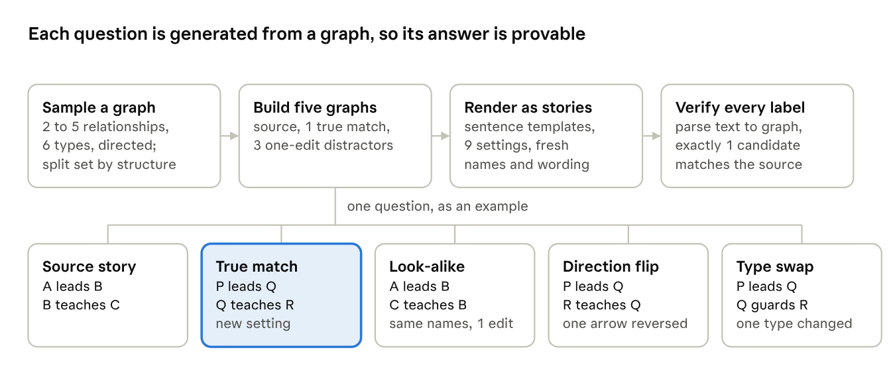
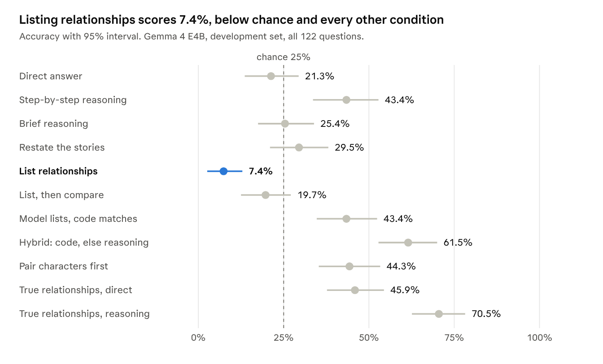
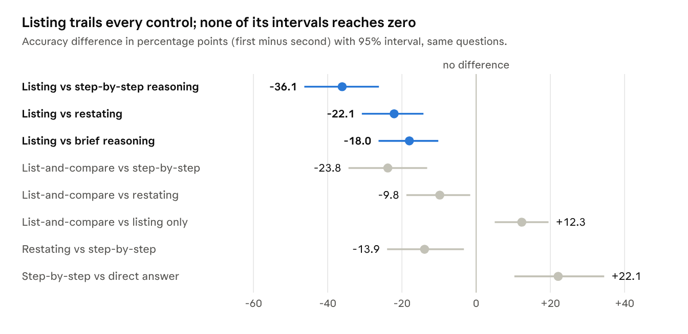
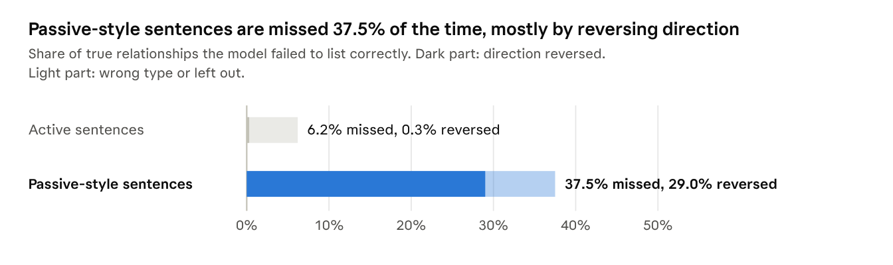
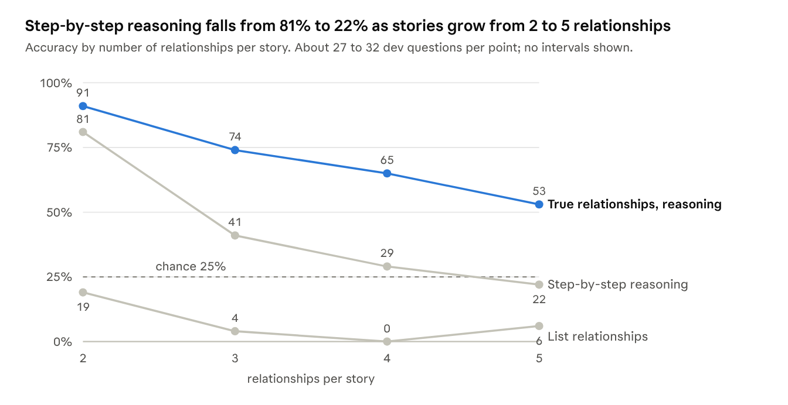

# Relationship Mapping in Structural Analogy Selection: Report and Technical Reference

Last updated 17 Nov 2026. This file is a copy of the project report; figures are in docs/figures/.

## Summary

On Gemma 4 E4B, asking the model to list relationships before answering lowers accuracy to 7.4%, below chance (25%) and 36.1 points below generic step-by-step reasoning (95% CI −46.3 to −26.2).

- **Listing is not special; it hurts.** It scores below all three controls (step-by-step reasoning, restating, brief reasoning), with every interval below zero.
- **Reading and matching fail equally.** Code matching on the model's own lists scores 43.4%; the model matching on the true relationships scores 45.9%.
- **Reading fails on passive-style sentences.** The model misses 37.5% of passive-style relationships against 6.2% of active ones.
- **Reasoning over true relationships works best.** It scores 70.5%, and 79.6% on replies that were not cut off.
- **Listing helps when code does the matching.** Code matching on the model's lists, with step-by-step reasoning when code cannot decide, scores 61.5%: 18.0 points above reasoning alone (95% CI +10.1 to +26.5).
- **Role binding decides the answer.** When the model pairs the characters correctly it answers right 82.7% of the time; when it pairs them wrongly, 14.5%.

Status: these are development-set results from one model and one prompt wording. The development run is complete: all 122 questions under all nine conditions, finished 17 Nov 2026. The 275 test questions have not been run.

Part 1 (sections 1 to 11) is the report. Part 2 (sections 12 to 18) is the technical reference. Section 19 is the hand-off for whoever continues the work, including AI agents: current state, rules and next steps.

## 1. Research questions

The project tests whether writing out relationships helps a language model choose the structurally analogous story, and where the model fails when it does not.

|  | Question | Why it was chosen |
| --- | --- | --- |
| Q3 | Is listing relationships better than generic reasoning of similar length? | Prior work compares listing only against a direct answer, so any gain could come from extra reasoning alone. |
| Q1 | When the model fails, is it misreading the relationships or failing to match them? | Prior benchmarks report one accuracy number and cannot separate the two stages. |

The task is four-choice structural analogy selection. Relationship extraction is a scored intermediate step, not the end task.

The proposal's original hypothesis was that explicit relationship mapping improves analogical reasoning. Q3 tests that hypothesis with a control; Q1 explains the outcome.

Context: this is a university course project (Advanced NLP, Fall 2026) carried out by a student team. The numbering Q1 and Q3 comes from three candidate questions drawn up while choosing the project's focus; the team chose to pursue Q1 and Q3 first and keep the one with more research value. The other candidate is not pursued.

## 2. Task and dataset

Each question gives one source story and four candidate stories; exactly one candidate has the same relational structure as the source.



*Source: dataset construction · 4 steps and the 5 stories of one question*

Only the true match has the same graph as the source; each distractor differs by exactly one edit.

- **Stories as graphs.** A story is a small directed graph of 2 to 5 relationships over six types: AUTHORITY, SUPPLY, TEACH, PROTECT, EVALUATE, OPPOSE.
- **Definition of analogy.** Two stories are analogous when their entities can be paired one-to-one so that every relationship keeps its type and direction.
- **Look-alike distractor.** It reuses the source's setting, names and wording with one structural edit, so surface similarity points to a wrong answer.
- **Text.** Each relationship is written from one of three sentence templates per setting; the third is passive-style.
- **Size.** 397 questions: 325 originals and 72 reworded twins of the same questions.

| Split | Questions | Purpose |
| --- | --- | --- |
| dev | 122 | Prompt tuning; all results in this report |
| test\_familiar | 145 | Familiar shapes and settings, unseen structures |
| test\_heldout\_shape | 60 | Graph shapes that appear in no other split |
| test\_heldout\_domain | 70 | Source or true match set in robots or theater |

Validity rests on automated checks, not human review. Every story parses back to its stored relationships, exactly one candidate matches per question, and no labeled structure is shared between dev and test. A word-overlap baseline (TF-IDF) picks the look-alike in 100% of questions. The code and templates were written with an AI assistant. A 40-question sample has been exported for human review and has not been annotated yet.

A real two-relationship question from the dev split (id q0001, answer A):

| Role | Text |
| --- | --- |
| Source | Aboard the pirate sloop Marigold, Mags gets gunpowder from Rosa. Meanwhile, Pell gets gunpowder from Rosa. |
| A. True match | Among the students of a small-town science club, Lila lends notes to Jonah. Meanwhile, Lila lends notes to Amara. |
| B. Look-alike (rewired) | Aboard the pirate sloop Marigold, Mags gets gunpowder from Rosa. Meanwhile, Pell gets gunpowder from Mags. |
| C. Direction flip | Within the walls of an old royal keep, Maren provides horses to Isolde. Linnet provides horses to Maren. |
| D. Type swap | On the night shift at a city hospital, Opal looks out for Ingrid. Tariq receives lab samples from Opal. |

The source uses the passive-style SUPPLY template ("gets gunpowder from"): Rosa supplies both Mags and Pell. The true match states the same structure actively: Lila supplies both Jonah and Amara. Full dataset specifications are in section 17.

## 3. Evaluation design

Each question is run under nine conditions that differ only in what the model sees and what it must write before answering.

| Condition | Model sees | Writes before answering | Who matches | What it isolates |
| --- | --- | --- | --- | --- |
| direct | stories | nothing | model | Baseline |
| cot | stories | free step-by-step reasoning | model | Effect of extra reasoning |
| cot\_brief | stories | reasoning, asked for 150 words or fewer | model | Reasoning at shorter length |
| restate | stories | each story in its own words | model | Re-reading without structure |
| extract\_llm | stories | every relationship as (head, TYPE, tail) | model | The proposal's method |
| extract\_compare | stories | the lists, then a comparison | model | Listing plus explicit comparison |
| extract\_code | stories | same lists as extract\_llm | code | Limited only by reading |
| gold\_llm | true relationships, no stories | nothing | model | Limited only by matching |
| gold\_cot | true relationships, no stories | free step-by-step reasoning | model | Matching with reasoning |

Round 2 added five more: map\_llm (the model pairs characters, then answers), map\_code (code checks the model's pairings), direct\_shuf and gold\_llm\_shuf (candidates moved two places), and hybrid (derived from extract\_code and cot, no model calls). Section 8 reports them.

- **Q3 comparison.** extract\_llm against cot, restate and cot\_brief. Listing is special only if it beats the controls with an interval above zero.
- **Q1 comparison.** extract\_code against gold\_llm. The first can only fail at reading; the second can only fail at matching.
- **Held constant.** The analogy rule, the relationship-type list, free-text output ending in `Answer: <letter>`, a 3000-token reply cap, and temperature 0.
- **Independence.** Each question is a separate request with no history, so question order cannot affect answers.
- **Statistics.** 95% intervals come from a bootstrap that resamples whole question groups (an original and its reworded twin), 2000 resamples. Differences are paired on the same questions.
- **Model.** Gemma 4 E4B, 4-bit quantized, run locally with llama.cpp.

## 4. Results: accuracy by condition

Listing relationships is the only condition below chance. Two conditions pass 50%: reasoning over the true relationships (70.5%) and the round-2 hybrid (61.5%, section 8).



*Source: results/gemma-4-E4B-q4.jsonl · dev split, all 122 questions per condition, final 17 Nov 2026*

Three groups appear. Conditions without free reasoning sit near chance. Step-by-step reasoning, reading-only and matching-only sit near 45%. Reasoning over true relationships reaches 70.5%.

| Condition | No answer | Cut off | Mean reply length (words) |
| --- | --- | --- | --- |
| direct | 0.0% | 0.0% | 2 |
| cot | 4.1% | 4.1% | 846 |
| cot\_brief | 0.0% | 0.0% | 374 |
| restate | 0.0% | 0.0% | 621 |
| extract\_llm | 0.0% | 0.0% | 68 |
| extract\_compare | 0.8% | 0.8% | 522 |
| extract\_code | 48.4% | 0.0% | 68 |
| gold\_llm | 0.0% | 0.0% | 2 |
| gold\_cot | 11.5% | 11.5% | 826 |

Two notes on this table. extract\_code gives no answer in 48.4% of questions because the model's lists matched no candidate or several. The model ignores the 150-word limit in cot\_brief.

## 5. Results for Q3: is listing special?

No. Listing scores 36.1 points below step-by-step reasoning (95% CI −46.3 to −26.2), and below restating and brief reasoning as well.



*Source: results/gemma-4-E4B-q4.jsonl · paired differences, dev split, cluster bootstrap with 2000 resamples*

The paired counts show how one-sided this is. Against step-by-step reasoning, listing was the only correct one on 1 question and reasoning on 45.

- **Where the wrong answers go.** After listing, 104 of 113 wrong answers are the look-alike story.
- **Correct lists do not help.** When all five lists were correct, the model answered right in 2 of 32 questions (6.2%).
- **Adding a comparison step helps a little.** List-and-compare gains 12.3 points over listing alone but stays 23.8 points below step-by-step reasoning.
- **Length is not the explanation.** Brief reasoning (374 words) and restating (621 words) both beat list-and-compare (522 words).

## 6. Results for Q1: reading or matching?

Both stages fail about equally: reading-only scores 43.4% and matching-only 45.9%, a paired difference of 2.5 points (95% CI −11.1 to +15.3).

The two stages fail on different questions. Matching-only was the only correct one on 34 questions and reading-only on 31.

**Reading.** The model's lists reach 85.6% precision and 83.6% recall (F1 84.6%). One wrong relationship in any of five stories breaks code matching, so all five stories are read correctly in only 26.7% of questions. Of 345 missed relationships, 203 are reversed, 95 have the wrong type and 47 are missing.



*Source: results/gemma-4-E4B-q4.jsonl · extract condition, 2,105 true relationships across 122 dev questions*

The passive-style template states the receiver of the action first. The model appears to assign direction by word order.

**Matching.** Given the true relationships, the model answers 45.9% correctly without reasoning and 70.5% with it, a gain of 24.6 points (95% CI +14.3 to +35.0). Its most common wrong pick without reasoning is the direction flip (36 of 66). Reasoning over true relationships also beats reasoning over stories by 27.0 points (95% CI +15.8 to +38.5).

## 7. Effect of story size

Accuracy drops sharply as stories grow, and fastest for free reasoning over stories.



*Source: results/gemma-4-E4B-q4.jsonl · dev split by number of relationships, 27 to 32 questions per point*

| Condition | 2 | 3 | 4 | 5 |
| --- | --- | --- | --- | --- |
| direct | 44% | 7% | 10% | 22% |
| cot | 81% | 41% | 29% | 22% |
| cot\_brief | 59% | 19% | 6% | 16% |
| restate | 53% | 33% | 3% | 28% |
| extract\_llm | 19% | 4% | 0% | 6% |
| extract\_compare | 28% | 15% | 13% | 22% |
| extract\_code | 47% | 52% | 48% | 28% |
| gold\_llm | 69% | 41% | 35% | 38% |
| gold\_cot | 91% | 74% | 65% | 53% |

Two patterns stand out. Code matching on the model's lists stays flat from 2 to 4 relationships, so reading does not get much harder with size; matching does. Several conditions score higher at 5 relationships than at 4 (restate 3% to 28%, direct 10% to 22%). This is unexplained and may be noise: each cell holds only 27 to 32 questions and has no interval. The 5-relationship stories also have the most cut-off replies (section 10).

## 8. Results, round 2: hybrid, role binding and answer order

Letting code match the model's relationship lists raises accuracy to 61.5%, the best result without true relationships. Asking the model to pair characters first does not raise accuracy, but shows that role binding decides the answer.

Three changes were tested on the same 122 dev questions on 17 Nov 2026, after the main run.

| Condition | What it is | Accuracy | 95% CI | Paired difference (95% CI) |
| --- | --- | --- | --- | --- |
| hybrid | extract\_code's answer when code finds exactly one match, otherwise cot's answer; no new model calls | 61.5% | 52.8 to 70.0 | +18.0 vs cot (+10.1 to +26.5) |
| map\_llm | the model pairs each source character with one in every candidate, then answers | 44.3% | 35.3 to 53.3 | +0.8 vs cot (−10.0 to +11.6) |
| map\_code | code checks which candidate the model's own pairings fit | 42.6% | 33.9 to 52.1 | −1.6 vs map\_llm (−8.5 to +5.7) |
| direct\_shuf | direct, with every candidate moved two places | 23.8% | 16.3 to 31.5 | +2.5 vs direct (−7.3 to +12.0) |
| gold\_llm\_shuf | gold\_llm, with every candidate moved two places | 47.5% | 37.9 to 57.4 | +1.6 vs gold\_llm (−7.3 to +10.8) |

**Hybrid.** Code gives an answer on 63 questions and is right on 84.1% of them. The other 59 fall back to step-by-step reasoning, which is right on 37.3%. The hybrid alone was right on 27 questions and cot alone on 5. It stays below reasoning over true relationships by 9.0 points, an interval that crosses zero (−20.3 to +2.5). By story size it scores 81%, 63%, 61% and 41% for 2 to 5 relationships, against 81%, 41%, 29% and 22% for cot. The rule was chosen after seeing dev results, so it must be confirmed on the test splits.

**Role binding.** The model's pairing for the true match was fully correct in 45.6% of questions (114 readable; 8 replies had no readable pairing). When the pairing was right, the model chose correctly in 82.7% of cases (52 questions); when it was wrong, in 14.5% (62 questions). Pairing does no better than generic reasoning, but beats listing relationships by 36.9 points (+27.6 to +45.8). The model ignored the requested `name = name` format and wrote pairings inline (for example `Rosa → Lila (Supplier)`), so pairings are read by finding the known character names on either side of an arrow or equals sign.

**Answer order.** With every candidate moved two places, direct answering picks the same story 43% of the time and the same letter 21%. With true relationships given, it is 52% and 19%. If the model followed position, the same letter would dominate; it does not, and accuracy does not change. The low twin stability in section 18 therefore reflects inconsistent answers, not a letter preference. A mild lean toward later letters remains: shifted direct answers picked D 47 times and A 19 times.

The full report output for this round is saved as `results_dev_round2.txt`.

## 9. Interpretation

The results suggest the model can find relationships but loses track of which entity plays which role, and listing makes this worse.

| Observation | Evidence | Confidence |
| --- | --- | --- |
| Listing lowers accuracy | Below all three controls, every interval below zero | High for this model and wording |
| The failure after listing is not a reading failure | 2 of 32 correct when all five lists were correct | High |
| After listing, the model picks the look-alike | 104 of 113 wrong answers | High |
| Name overlap causes that pull | The look-alike's list shares the source's names | Hypothesis; not tested |
| Direction is the weak point in reading | 203 of 345 missed relationships are reversals | High |
| Direction is the weak point in matching | Most common wrong pick under gold\_llm is the direction flip (36 of 66) | Medium |
| Free reasoning helps when the model matches; structure helps when code matches | cot gains 22.1 points over direct; gold\_cot gains 24.6 over gold\_llm; the hybrid gains 18.0 over cot | High |
| Answers follow content more than position | With candidates moved two places, the same story is picked in 43% to 52% of cases and the same letter in 19% to 21%; accuracy unchanged | Medium; 122 questions |

The model also matches relationship types better than arrangement. Its wrong picks keep the source's types in 73% to 91% of cases, against about 56% expected by chance.

Round 2 (section 8) supports the role-binding account directly. The model's pairing for the true match is right in under half of questions, and that pairing almost fully decides whether its answer is right (82.7% against 14.5%). The practical consequence: the model is a usable reader, but should not do the matching. Whether name overlap is what breaks binding after listing is still untested.

## 10. Limitations

The findings hold for one small model on templated text and have not been checked on the test splits.

- **One model.** Gemma 4 E4B at 4-bit quantization. A larger model may behave differently; Gemma 12B does not fit on the available laptop.
- **One prompt wording.** Each condition has a single phrasing. The listing result could depend on it.
- **Development set only.** All 122 dev questions are complete. The 275 test questions are untouched by design.
- **Templated stories.** Text comes from fixed sentence templates. Transfer to natural text is untested.
- **No human validation yet.** Labels are verified by code. The 40-question review sample has not been annotated.
- **Token cap.** 4.1% of cot replies and 11.5% of gold\_cot replies were cut off at 3000 tokens, mostly on five-relationship stories, and count as wrong.
- **Missing baselines.** Random, fixed-position and embedding-similarity baselines from the proposal are not run. Only TF-IDF is.
- **Story size.** The proposal specified 2 to 3 relationships. The dataset goes to 5; the team has not formally agreed to this.
- **Literature review.** Related work was read through summaries and is not exhaustive.

## 11. Next round

The next round tests whether listing hurts in general or only when the source's names stay visible.

| Priority | Change | What it tests | Cost |
| --- | --- | --- | --- |
| 1 | Done: full dev run (17 Nov 2026) | Complete dev numbers | None remaining |
| 2 | Two-step pipeline: the model lists in one call, then matches from the list alone with reasoning | The proposal's method in its strongest form | One new condition |
| 3 | Neutral names: replace names with X1, X2 in the lists before matching | Whether name overlap pulls the model to the look-alike | One new condition |
| 4 | Baselines: random, fixed position, embedding similarity | Anchors the results table; promised in the proposal | No model calls for the first two |
| 5 | Rerun cut-off replies with a 6000-token cap | Whether the cap changes any conclusion | 20 replies |
| 6 | Look-alike distractor with different names (dataset variant) | The same name question from the dataset side | Build change, re-verify |
| 7 | A passive-sentence example in the listing prompt | Whether reading errors are fixable by prompting | Prompt edit, dev only |
| 8 | A second wording of every prompt | That results are not tied to one phrasing | Doubles run time |

After these, the prompts are frozen and the 275 test questions are run once.

Further candidate changes, proposed after the full dev run (17 Nov 2026):

| Change | What it tests | Status |
| --- | --- | --- |
| Hybrid: model lists, code matches, step-by-step reasoning when code cannot decide | Whether listing helps when the model does not do the matching | Done (section 8): 61.5%, +18.0 vs cot (95% CI +10.1 to +26.5); confirm on test |
| Entity-mapping prompt: write the source-to-candidate pairing, then answer | The role-binding hypothesis; scorable against the stored gold mappings | Done (section 8): pairing right in 45.6%; accuracy 82.7% when right, 14.5% when wrong |
| Shuffled candidate order for direct and gold\_llm | How much answers follow position | Done (section 8): little position effect |
| Re-read step when code finds no match or several | Recovers the 48% of questions where code abstains | Proposed |
| Letter probabilities instead of the written letter | Confidence and fewer unparsed replies | Proposed |
| Prompt fingerprint stored with every result row; own git repository | Prevents old and reworded prompts mixing in one results file | Proposed |
| Second model family (8B, hosted) | That results are not specific to Gemma | Decided: run after the pipeline is finalized, together with the test splits |

Open team decisions:

- [ ] Lead question: Q3 with Q1 as the mechanism (recommended), or Q1 alone
- [ ] Keep stories of up to 5 relationships, or return to the proposal's 2 to 3
- [ ] Whether and where to run Gemma 12B (hosted endpoint or Colab)
- [ ] Whether to add a natural-text transfer check
- [ ] Who annotates the 40-question review sample

## 12. Reference: design decisions and reasons

Each decision below was made to remove a specific alternative explanation for the results.

| Area | Decision | Reason |
| --- | --- | --- |
| Dataset | Generate stories from graphs | The correct answer is provable by graph matching, and reading errors can be scored against known relationships. |
| Dataset | Six relationship types, none the converse of another | A reversed relationship can never be re-expressed as a different valid type, so direction errors are unambiguous. |
| Dataset | Each distractor differs by exactly one edit | Wrong answers show which property the model ignored: direction, type or arrangement. |
| Dataset | Look-alike shares setting, names and wording with the source | Any method that relies on surface overlap is driven to a wrong answer. |
| Dataset | Third template per relationship is passive-style | Tests whether the model reads direction from meaning or from word order. |
| Dataset | Split decided by structure hash, never at random | Guarantees no labeled structure is shared between dev and test. |
| Dataset | Two held-out test splits (shapes, settings) | Separates generalization to new structure from generalization to new vocabulary. |
| Dataset | 20% of questions get a reworded twin | Measures sensitivity to wording with structure held fixed. |
| Dataset | Answer position rotated | Positions are balanced: A 101, B 100, C 98, D 98. |
| Evaluation | restate and cot\_brief controls | Separate the effect of listing from re-reading and from reply length. |
| Evaluation | extract\_code and gold\_llm | Split the pipeline into a reading-only and a matching-only measurement. |
| Evaluation | Same free-text format and token cap for all write-first conditions | An earlier JSON format for listing was a confound against free-text reasoning. |
| Evaluation | Same relationship-type list in every prompt | Listing must not receive information the controls lack. |
| Evaluation | Temperature 0, one request per question | Repeatable results and no carry-over between questions. |
| Evaluation | Bootstrap over question groups, paired differences | Twins are not independent; pairing removes question difficulty from comparisons. |
| Evaluation | All tuning on dev; test run once after prompts are frozen | Keeps test results free of prompt selection. |
| Tooling | OpenAI-compatible endpoint, no extra packages | Any local or hosted model can be evaluated with the same code. |
| Tooling | Results file is append-only and resumable | A stopped run loses nothing. |

## 13. Reference: problems found and fixes

Eight problems were found during setup and two pilot runs; each was fixed before the development run.

| Problem | Effect | Fix |
| --- | --- | --- |
| Gemma 4 produces hidden reasoning by default | Replies came back empty | Server started with `--reasoning off` |
| cot replies cut off at 700 tokens, then at 1500 (47.5% cut off in the pilot) | cot accuracy understated | Cap raised to 3000 for every write-first condition; server context set to 8192 |
| gold condition ignored the answer-only instruction | Replies cut off at 16 tokens with no answer | Added "Do not explain or restate anything" to direct and gold prompts |
| Listing required JSON while reasoning was free text | Format confound in the Q3 comparison | Listing changed to free-text lines under headings |
| Listing compared only against a direct answer and cot | Could not rule out re-reading or length effects | Added restate, cot\_brief and extract\_compare |
| gold\_llm low with no way to tell why | Matching ability unclear | Added gold\_cot |
| Pilots ran on a sample of the dev questions | Too few questions for intervals | Full dev set of 122 questions run |
| Session ended mid-run | Server and run stopped at 44 of 122 | Run resumed from the saved results file |

Two setup choices were made at the team's request: the pre-installed Ollama is not used, and API keys are set only through the `RELMAP_API_KEY` environment variable.

## 14. Reference: setup, commands and files

The project needs Python 3.10 or later, no extra packages, and any server that speaks the OpenAI chat-completions format.

Start the model server (from the project folder):

```bash
tools/llama.cpp/llama-server.exe -m gemma-4-E4B_q4_0-it.gguf --host 127.0.0.1 --port 8080 -ngl 99 -c 8192 --parallel 1 --reasoning off
```

Build, check, run and report:

```bash
python -m relmap.build
python -m relmap.verify data/questions.jsonl
python -m relmap.evaluate run --model gemma-4-E4B-q4 --base-url http://127.0.0.1:8080/v1 --split dev
python -m relmap.evaluate report results/gemma-4-E4B-q4.jsonl
python -m relmap.review_sample --n 40 --seed 7
```

The run command resumes from the results file if it is stopped. `--model mock` runs offline to test the pipeline. `--limit N` samples whole question groups.

| File | Contents |
| --- | --- |
| `relmap/schema.py` | Relationship types, nine settings, names, sentence templates |
| `relmap/graphs.py` | Graph matching, random graphs, single-edit distractors |
| `relmap/realize.py` | Graph to story text, and text back to graph |
| `relmap/build.py` | Builds questions and assigns splits (seed 13) |
| `relmap/verify.py` | Label checks, split-leak checks, TF-IDF baseline |
| `relmap/evaluate.py` | Prompts, model calls, scoring and the report |
| `relmap/review_sample.py` | Exports the human-review sheet and its answer key |
| `data/questions.jsonl` | The 397 questions |
| `data/review/` | Review sheet (no answers) and answer key |
| `results/gemma-4-E4B-q4.jsonl` | One row per question and condition, with the raw reply |
| `tools/llama.cpp/` | llama.cpp build b12445 (Windows, CUDA 12.4) |

Each question record holds: id, split, paraphrase group, number of relationships and entities, shape id, structure id, the source story, four candidates with role and edit type, the answer letter, and the gold entity mappings.

## 15. Reference: prompts and metrics

Every prompt has the same body and differs only in its final instruction.

Shared body:

```text
Two stories are analogous when their entities can be paired one-to-one so that every relationship in one story corresponds to a relationship of the same type and the same direction in the other. Names, settings and wording do not matter.

Relationship types:
- AUTHORITY: X directs or commands Y
- SUPPLY: X provides goods or materials to Y
- TEACH: X trains or instructs Y
- PROTECT: X defends or shields Y
- EVALUATE: X checks or judges Y's work
- OPPOSE: X works against or harms Y

Source story:
<source>

Candidates:
A. <story>
B. <story>
C. <story>
D. <story>

Exactly one candidate is analogous to the source. <final instruction>
```

In the gold conditions the stories are replaced by their true relationships, written as `(head, TYPE, tail)` and headed "Source relationships".

| Condition | Final instruction |
| --- | --- |
| direct, gold | Do not explain or restate anything. Reply with only this line: Answer: \<letter> |
| cot, gold\_cot | Think step by step, then end with a final line in exactly this form: Answer: \<letter> |
| cot\_brief | Reason briefly, in at most 150 words, then end with a final line in exactly this form: Answer: \<letter> |
| restate | First restate the source story and each candidate story in your own words, under the headings Source, A, B, C and D. Then end with a final line in exactly this form: Answer: \<letter> |
| extract | First list every relationship in the source story and in each candidate story, one per line as (head, TYPE, tail) using the relationship types above, under the headings Source, A, B, C and D. Then end with a final line in exactly this form: Answer: \<letter> |
| extract\_compare | The extract instruction, then: Then, under the heading Comparison, check each candidate's list against the source list. Then end with the answer line. |

Round 2 prompts: direct\_shuf and gold\_shuf reuse the direct and gold instructions with candidates moved two places (A to C, B to D, C to A, D to B). The map instruction is: "First, for each candidate story, pair every character in the source story with the character in that candidate who plays the same role, one pair per line as \<source name> = \<candidate name>, under the headings A, B, C and D. Then end with a final line in exactly this form: Answer: \<letter>". Its cap is 3000 tokens.

Reply caps: 16 tokens for direct and gold, 3000 for all others.

| Metric | Definition |
| --- | --- |
| Accuracy | Share of questions answered with the correct letter. No answer and cut-off replies count as wrong. |
| No answer | No `Answer: <letter>` line found. For extract\_code, the model's lists matched zero or several candidates. |
| Cut off | The reply reached the token cap. |
| extract\_code | Code tests graph matching between the model's source list and each candidate list; it answers only when exactly one matches. |
| Reading precision, recall, F1 | The model's listed relationships against the true ones, over all five stories. |
| Reading error cause | Each missed relationship is classed as reversed direction, wrong type, or missing. |
| Sentence style | Reading errors split by whether the sentence used an active or the passive-style template. |
| Twin stability | Share of original and reworded pairs with the same outcome (both right or both wrong). |
| Wrong-pick type | Whether a wrongly chosen story kept the source's relationship types (arrangement error) or changed one. |
| Finished accuracy | Accuracy over replies that were not cut off. |

## 16. Reference: related work and the gap

None of the ten prior works surveyed combines gold relational graphs, a generic-reasoning control and a reading-versus-matching error split.

Works surveyed: ARN, AnaloBench, ParallelPARC, SCAR, Inani et al. (CogSci 2025), YARN (arXiv 2603.29997), Lee et al. (AAAI 2026), Das and Balke (INLG 2025), REL and NARB. YARN is the closest to this project.

| Feature | Status in the surveyed work | This project |
| --- | --- | --- |
| Gold relational graph for every story | Not found | Yes; stories are generated from graphs |
| Control for generic reasoning when testing relationship listing | Not found | cot, cot\_brief and restate |
| Separate scores for reading and for matching | Not found | extract\_code and gold\_llm |

This survey was done from paper summaries and is not exhaustive. The team should read YARN and the two closest benchmarks in full before claiming the gap in a paper.

## 17. Reference: dataset specification

The dataset is fully reproducible from `python -m relmap.build` with seed 13; every number below comes from `python -m relmap.verify`.

**Relationship types.** Each is directed from X to Y.

| Type | Meaning |
| --- | --- |
| AUTHORITY | X directs or commands Y |
| SUPPLY | X provides goods or materials to Y |
| TEACH | X trains or instructs Y |
| PROTECT | X defends or shields Y |
| EVALUATE | X checks or judges Y's work |
| OPPOSE | X works against or harms Y |

**Settings.** Nine settings, each with its own opening line, 10 character names and three sentence templates per relationship type. Templates 1 and 2 are active (X first); template 3 is passive-style (Y first).

| Setting | Used in | Example AUTHORITY templates (1, 2, 3) |
| --- | --- | --- |
| office | all splits | X supervises Y; X manages Y; Y reports to X |
| starship | all splits | X commands Y; X gives orders to Y; Y takes orders from X |
| school | all splits | X assigns tasks to Y; X is in charge of Y; Y answers to X |
| castle | all splits | X rules over Y; X gives commands to Y; Y serves under X |
| kitchen | all splits | X gives instructions to Y; X directs Y; Y takes direction from X |
| hospital | all splits | X oversees Y; X directs Y's rounds; Y answers to X |
| pirates | all splits | X gives orders to Y; X commands Y; Y obeys X |
| robots | test\_heldout\_domain only | X issues directives to Y; X controls Y's task queue; Y executes directives from X |
| theater | test\_heldout\_domain only | X gives stage directions to Y; X directs Y; Y takes direction from X |

**Generation rules.**

1. Sample a random directed graph with the requested number of relationships (2, 3, 4 or 5). With probability 0.3 all relationships share one type.
2. Assign the split by hashing the graph. A shape (the graph with types removed) is held out when its hash is divisible by 5. Otherwise, structures with an even hash go to dev and odd ones to the test splits.
3. Keep the graph only if at least one reversal changes its structure, so a direction-flip distractor exists.
4. Build the true match by renaming entities into another setting. Build three distractors, each one edit from the source and not isomorphic to it: the look-alike (reverse, relabel or rewire, chosen at random; same setting, names and template choices as the source), a direction flip (one reversal) and a type swap (one relabel), each in another setting.
5. For test\_heldout\_domain, the source is in robots or theater with probability 0.67; otherwise the true match is.
6. Render each graph with randomly chosen templates, then shuffle the candidates, rotating the answer position A, B, C, D in turn per split.
7. With probability 0.2, add a reworded twin: same graphs, new template choices, new answer position.

Quota: 25 dev, 30 test\_familiar, 15 test\_heldout\_shape and 15 test\_heldout\_domain originals per relationship count, before twins.

| Split | 2 rel. | 3 rel. | 4 rel. | 5 rel. | Total |
| --- | --- | --- | --- | --- | --- |
| dev | 32 | 27 | 31 | 32 | 122 |
| test\_familiar | 38 | 36 | 33 | 38 | 145 |
| test\_heldout\_shape | 0 | 19 | 20 | 21 | 60 |
| test\_heldout\_domain | 15 | 19 | 17 | 19 | 70 |

test\_heldout\_shape has no two-relationship questions because no two-relationship shape meets the held-out hash rule.

| Statistic | Value |
| --- | --- |
| Questions | 397 (325 originals, 72 twins; 22 twins in dev) |
| Distinct labeled structures | 296 |
| Distinct shapes | 116 |
| Entities per story | 2: 22, 3: 129, 4: 105, 5: 79, 6: 62 questions |
| Answer positions | A 101, B 100, C 98, D 98 |
| Look-alike edit type | reverse 150, relabel 135, rewire 112 |
| Source setting | pirates 64, castle 58, starship 54, kitchen 49, office 49, school 41, hospital 33, robots 25, theater 24 |
| TF-IDF baseline | picks the look-alike in 100% of questions |

**Human review sample.** `python -m relmap.review_sample --n 40 --seed 7` draws 40 originals spread over split and size: 12 dev, 12 test\_familiar, 10 test\_heldout\_domain, 6 test\_heldout\_shape. Annotators get `review_sheet.csv` (no answers) and fill in their answer, a 1 to 5 naturalness score, whether more than one candidate fits, and notes. `review_key.csv` holds the answers and distractor types. 28 of the 40 items are test questions; human review does not tune prompts, so this does not break the test rule.

## 18. Reference: additional results

These tables complete the development-set results from the final run (all 122 questions under all nine conditions). The full report output is saved as `results_dev_final.txt`.

| Condition | Accuracy | 95% CI | Questions | Finished-reply accuracy | Twin stability (22 pairs) |
| --- | --- | --- | --- | --- | --- |
| direct | 21.3% | 13.6 to 29.4 | 122 | 21.3% | 82% |
| cot | 43.4% | 33.6 to 52.8 | 122 | 45.3% | 77% |
| cot\_brief | 25.4% | 17.5 to 33.9 | 122 | 25.4% | 73% |
| restate | 29.5% | 21.0 to 38.1 | 122 | 29.5% | 77% |
| extract\_llm | 7.4% | 2.6 to 12.9 | 122 | 7.4% | 86% |
| extract\_compare | 19.7% | 12.5 to 27.1 | 122 | 19.8% | 64% |
| extract\_code | 43.4% | 34.7 to 52.4 | 122 | 43.4% | 45% |
| gold\_llm | 45.9% | 37.7 to 54.4 | 122 | 45.9% | 41% |
| gold\_cot | 70.5% | 62.6 to 78.2 | 122 | 79.6% | 55% |

All paired comparisons (first minus second, percentage points):

| Comparison | Difference | 95% CI | Only first right | Only second right |
| --- | --- | --- | --- | --- |
| extract\_llm − cot | −36.1 | −46.3 to −26.2 | 1 | 45 |
| extract\_llm − restate | −22.1 | −30.8 to −14.2 | 2 | 29 |
| extract\_llm − cot\_brief | −18.0 | −26.3 to −10.2 | 4 | 26 |
| extract\_compare − cot | −23.8 | −34.4 to −13.2 | 7 | 36 |
| extract\_compare − restate | −9.8 | −18.8 to −1.6 | 9 | 21 |
| extract\_compare − extract\_llm | +12.3 | +5.0 to +19.5 | 18 | 3 |
| restate − cot | −13.9 | −24.0 to −3.3 | 11 | 28 |
| cot − direct | +22.1 | +10.3 to +34.5 | 40 | 13 |
| gold\_llm − extract\_code | +2.5 | −11.1 to +15.3 | 34 | 31 |
| gold\_cot − gold\_llm | +24.6 | +14.3 to +35.0 | 40 | 10 |
| gold\_cot − cot | +27.0 | +15.8 to +38.5 | 44 | 11 |
| gold\_llm − direct | +24.6 | +14.6 to +34.7 | 39 | 9 |

Wrong answers by distractor chosen, and letters chosen:

| Condition | Look-alike | Direction flip | Type swap | Kept source's types | Letters A / B / C / D / none |
| --- | --- | --- | --- | --- | --- |
| direct | 56 | 32 | 8 | 76 of 96 | 20 / 27 / 39 / 36 / 0 |
| cot | 41 | 21 | 2 | 54 of 64 | 30 / 27 / 37 / 23 / 5 |
| cot\_brief | 71 | 19 | 1 | 75 of 91 | 31 / 34 / 28 / 29 / 0 |
| restate | 69 | 17 | 0 | 68 of 86 | 29 / 22 / 36 / 35 / 0 |
| extract\_llm | 104 | 7 | 2 | 83 of 113 | 22 / 29 / 40 / 31 / 0 |
| extract\_compare | 63 | 33 | 1 | 84 of 97 | 37 / 23 / 35 / 26 / 1 |
| extract\_code | 4 | 5 | 1 | 9 of 10 | 16 / 17 / 15 / 15 / 59 |
| gold\_llm | 21 | 36 | 9 | 51 of 66 | 24 / 41 / 33 / 24 / 0 |
| gold\_cot | 10 | 12 | 0 | 20 of 22 | 31 / 32 / 23 / 22 / 14 |

By chance, about 56% of distractors keep the source's relationship types and 44% change one. The correct answer is spread evenly over A to D. The type-swap distractor is rarely chosen in every condition: the model notices a changed type more easily than a changed direction or arrangement.

Reading accuracy (extract condition, 2,105 true relationships): precision 85.6%, recall 83.6%, F1 84.6%. extract\_llm accuracy was 6.2% when all lists were correct (32 questions) and 8.0% when at least one had an error (88 questions); the lists of 2 questions could not be parsed.

A first pilot, run before the fixes in section 13, is kept in `results/gemma-4-E4B-q4.pilot1.jsonl` for reference and is not used in any number here.

## 19. Hand-off: current state and how to continue

This section is written for whoever continues the project, person or AI agent. Read it before changing any code or data.

**State on 17 Nov 2026.** The development run is complete: 122 questions under 9 conditions, 1,098 model replies. Round 2 (map, shuffled order, hybrid) is also complete on dev. Main-run numbers match `results_dev_final.txt`; round-2 numbers match `results_dev_round2.txt`, which also repeats the main-run numbers. The llama.cpp server may still be running; stop it when the machine is not in use. No test question has been sent to any model. An earlier provisional progress report (43 questions) is superseded by this document.

**Environment.**

| Item | Value |
| --- | --- |
| Machine | Windows 11 laptop, NVIDIA RTX 3060 Laptop GPU, 6 GB |
| Python | 3.10 or later; standard library only |
| Model | `gemma-4-E4B_q4_0-it.gguf` (5.15 GB) in the project folder |
| Server | llama.cpp build b12445, Windows CUDA 12.4, in `tools/llama.cpp/` |
| Endpoint | `http://127.0.0.1:8080/v1`, OpenAI chat-completions format |
| Version control | Public GitHub repository RMapLLM; this report is docs/REPORT.md there |

**Rules to keep.**

1. Tune prompts on dev only. Run the three test splits once, after the team freezes the prompts.
2. Do not use the Ollama install on this machine; the team chose llama.cpp.
3. Pass API keys only through the `RELMAP_API_KEY` environment variable. Never write a key into a file, a prompt or a chat.
4. Every condition keeps the same analogy rule, relationship-type list and `Answer: <letter>` ending, and every write-first condition keeps the same token cap. Otherwise the comparisons in section 5 are confounded.
5. Report that the dataset code and templates were written with an AI assistant.

**Known quirks.**

- Gemma 4 thinks silently by default and then returns an empty reply. Always start the server with `--reasoning off`.
- The server needs `-c 8192` so a 3000-token reply fits after the prompt.
- The run resumes by (question id, condition). Changing a prompt's wording does not invalidate old rows: write to a new results file or delete those rows first.
- `results_dev.log` is only written when the run ends. To check progress during a run, use the report command below.
- Gemma 12B (about 7 GB at 4-bit) does not fit in 6 GB of GPU memory; it needs a hosted endpoint or Colab.

**Other models.** Run `python -m relmap.evaluate check --model <name> --base-url <url>` before any full run. It sends a few dev questions, writes nothing, and reports empty replies, cut-offs and unreadable answers with the fix. For models that think before answering, either turn thinking off on the server, or send `--extra-body '{"chat_template_kwargs": {"enable_thinking": false}}'` (tested with Gemma 4 on llama.cpp), or raise `--answer-cap`. Other options: `--temperature none` and `--token-param max_completion_tokens` for APIs that reject those fields. Reasoning printed inside a reply (`<think>` tags or a harmony analysis channel) is removed before scoring. Every row records the model, request settings and a prompt fingerprint (`prompt_id`). After any parser change, run `python -m relmap.evaluate rescore <results file>`; rescoring the Gemma results with the current parsers changed no answers.

Check progress or regenerate all numbers:

```bash
python -m relmap.evaluate report results/gemma-4-E4B-q4.jsonl
```

**Adding a condition** (in `relmap/evaluate.py`):

1. Add its final instruction to `ENDINGS`. If it answers without writing first, also add it to `ANSWER_ONLY` (16-token cap); otherwise it gets the 3000-token cap.
2. Add it to `ORDER` (report order) and to the default `--conditions` list. A condition starting with `gold` is shown true relationships instead of stories.
3. Add any new paired comparison in `report`.
4. Run it on dev with `--conditions <name>`; the other conditions' rows are reused.

**Results row fields.** id, group, split, n\_edges, answer, condition, raw\_condition, pred, correct, picked\_role, picked\_edit, response (the full reply), output\_tokens, output\_words, cut\_off. extract\_llm rows add `extraction` (the parsed lists and their reading scores); extract\_code rows add `n_code_matches` (how many candidates the code matched).

**Next steps,** in order: decide with the team whether the hybrid becomes the main pipeline; run the cheap baselines; add the neutral-name and two-step conditions; try the re-read step for questions where code finds no match; rerun cut-off replies with a higher cap; take the open decisions in section 11 to the team; freeze prompts; run the 275 test questions once; annotate the review sample.
